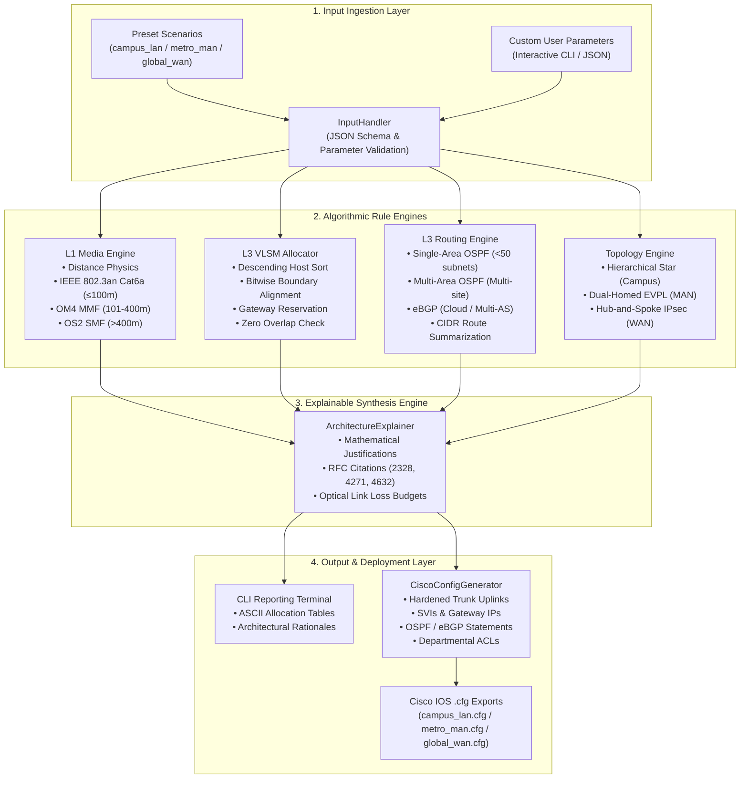

# NetArchitect: Visual Verification & Screenshots Guide

**Course Code**: CIC-307 • Computer Networks Mini-Project  
**Document**: Visual Evidence Checklist & Execution Guide  

This guide provides step-by-step instructions for capturing genuine, reproducible screenshots from the working NetArchitect application for project submission, viva defense, and documentation.

---

## System Architecture Diagram

---

## 6 Mandatory Screenshots Checklist

Capture the following 6 genuine screenshots on your machine:

### Screenshot 1: Main Interactive CLI Menu
- **What it demonstrates**: Application launch and scenario selector interface.
- **How to capture**:
  1. Open Windows PowerShell or Command Prompt.
  2. Navigate to project root: `cd mini-project-cn`
  3. Execute: `python main.py`
  4. Capture the terminal window displaying the NetArchitect ASCII banner and the 5 menu choices.
- **Recommended Filename**: `screenshot_1_main_menu.png`

### Screenshot 2: Campus LAN Recommendation Output
- **What it demonstrates**: Scenario execution showing summary, physical media analysis, and topology design.
- **How to capture**:
  1. In the main menu, press `1` (Campus LAN).
  2. Capture the output section showing the Executive Summary, Physical Layer (L1) Media Recommendation (Cat6a / OM4), and Topology & Resiliency Design.
- **Recommended Filename**: `screenshot_2_campus_lan_overview.png`

### Screenshot 3: VLSM Allocation Output Table
- **What it demonstrates**: Bitwise VLSM subnet allocator output with descending sort, gateway reservations, subnet masks, and utilization efficiency metrics.
- **How to capture**:
  1. Scroll down to Section `[3] VARIABLE LENGTH SUBNET MASK (VLSM) BITWISE ALLOCATION (RFC 4632)`.
  2. Capture the cleanly formatted ASCII table displaying Subnet Name, VLAN ID, Hosts Requested, Prefix, Network Address, Subnet Mask, Default Gateway, Broadcast Address, and Efficiency %.
- **Recommended Filename**: `screenshot_3_vlsm_table.png`

### Screenshot 4: Routing and Media Recommendation Output
- **What it demonstrates**: Dynamic routing protocol decision (Single-Area OSPF vs Multi-Area vs eBGP), RFC citations, and calculated Route Summarization supernets.
- **How to capture**:
  1. In the same run (or running Metro MAN / Global WAN via `python main.py --preset metro_man`), scroll to Section `[4] LAYER 3 ROUTING PROTOCOL & SUMMARIZATION`.
  2. Capture the protocol selection, Dijkstra SPF justification, and calculated supernets (`area 1 range 172.16.0.0 255.255.252.0`).
- **Recommended Filename**: `screenshot_4_routing_recommendation.png`

### Screenshot 5: Generated Cisco Configuration File
- **What it demonstrates**: Production-ready Cisco IOS `.cfg` output with VLAN definitions, hardened trunk allowed lists, SVIs, and OSPF/BGP statements.
- **How to capture**:
  1. Open `exports/campus_lan.cfg` or `exports/metro_man.cfg` in VS Code or Notepad.
  2. Capture the editor window showing lines with `spanning-tree mode rapid-pvst`, `switchport trunk allowed vlan`, `interface VlanX`, and `router ospf`.
- **Recommended Filename**: `screenshot_5_cisco_config.png`

### Screenshot 6: Successful Pytest Execution
- **What it demonstrates**: 100% automated test verification across 46 comprehensive unit tests.
- **How to capture**:
  1. In terminal, run: `python -m pytest -v tests/`
  2. Capture the final output showing `46 passed in 0.38s` with all green PASSED indicators.
- **Recommended Filename**: `screenshot_6_pytest_verification.png`

---

## Instructions for Cisco Packet Tracer / GNS3 Verification

To verify the role-separated configurations in Cisco Packet Tracer:

1. **Launch Cisco Packet Tracer** (e.g., Packet Tracer 9.0.1 or 8.x).
2. **Add Devices to the Canvas**:
   - Add one **Cisco Catalyst 3650-24PS** Multi-Layer Switch for the Core/Distribution layer.
   - Add one **Cisco Catalyst 2960-24TT** Switch for the Access layer.
   - Add one **Cisco ISR 4321** Integrated Services Router for the Edge Gateway.
3. **Cabling**:
   - Connect Core Switch `GigabitEthernet1/0/1` to Access Switch `GigabitEthernet0/1` (Trunk Uplink).
   - Connect Core Switch `GigabitEthernet1/0/24` to Edge Router `GigabitEthernet0/0/0` (Routed Interconnect).
4. **Load Configurations by Device Role**:
   - Open `exports/campus_lan.cfg` in a text editor.
   - **For Core Switch**: Open Core Switch CLI, type `enable` and `configure terminal`, copy the commands under `DEVICE 1 OF 3: CORE / MULTILAYER DISTRIBUTION SWITCH`, and paste into the console.
   - **For Access Switch**: Open Access Switch CLI, type `enable` and `configure terminal`, copy the commands under `DEVICE 2 OF 3: ACCESS LAYER EDGE SWITCH`, and paste into the console.
   - **For Edge Router**: Open Edge Router CLI, type `enable` and `configure terminal`, copy the commands under `DEVICE 3 OF 3: ENTERPRISE WAN EDGE ROUTER`, and paste into the console.
5. **Inspect Operational State & Capture Evidence**:
   - On Core Switch: `show ip interface brief` (verify all departmental SVIs and Vlan99 are Up/Up with exact VLSM gateway IPs).
   - On Core Switch: `show vlan brief` (verify VLANs 10, 20, 30, 40, 50, 99, 999 exist).
   - On Core Switch: `show interfaces trunk` (verify trunk native VLAN is 999 and allowed list is `99,10,30,20,40,50`).
   - On Access Switch: `show interfaces status` (verify FastEthernet0/1-5 in VLAN 10, 0/21-24 in VLAN 50 with PortFast/BPDU Guard).
   - On Access Switch: `ping 10.255.99.1` (verify ping to Core Switch management gateway succeeds).
   - On Core Switch: `show ip access-lists` (verify `HARDENED-INTERVLAN-ACL` rules show deny before broad permit).
   - On Edge Router: `show ip ospf neighbor` (verify OSPF adjacency with Core Switch on Gi0/0/0).
   - On Edge Router: `show ip route ospf` (verify OSPF routes learned from Core Switch).

